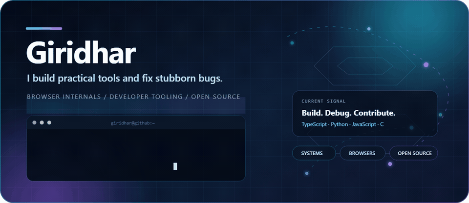

  

  
  
  
  
  

I’m **Giridhar**. I like taking awkward, real-world problems—legacy GPU crashes, browser-extension persistence, brittle validation paths—and turning them into small tools or focused upstream fixes.

I came to software from electrical engineering, so my instinct is to reproduce, isolate, and measure before rewriting anything.

My current work is mostly around **developer tooling**, **browser internals**, **MCP integrations**, and **open-source bug fixing**.

## Selected work

- **[Persistent XPI Toolkit](https://github.com/giri256/persistent-xpi-toolkit)** — an unofficial Firefox 152.0.6 source patch and verifier for persistent unsigned WebExtension testing in normal release builds.
- **[Blender HD 4000 crash investigation](https://github.com/giri256/blender-hd4000-crash-report)** — a reproducible Windows/GLSL failure analysis submitted to Blender's tracker and Intel's graphics community.
- **[Claude Continue](https://github.com/giri256/claude-continue)** — a Manifest V3 extension that resumes a Claude chat when its message limit resets.
- **[Vocab Builder TTS](https://github.com/giri256/Vocab-Builder-TTS)** — a Python tool that turns vocabulary lists into definitions, examples, and listenable study audio.

## Open-source work

### Merged

- **[Super Productivity #9183](https://github.com/super-productivity/super-productivity/pull/9183)** — reset shared dialog state between tests to prevent cross-spec leakage.

### In review

- **[Elastic Kibana #279376](https://github.com/elastic/kibana/pull/279376)** — validate detection-rule schedules across create, update, and partial PATCH flows.
- **[Agno #9078](https://github.com/agno-agi/agno/pull/9078)** — expose `FileTools.list_files(directory=...)` in generated tool schemas.
- **[Linux Test Project #1337](https://github.com/linux-test-project/ltp/pull/1337)** — add a portable `noinline` attribute helper.
- MCP integrations for **[Blender](https://github.com/ahujasid/blender-mcp/pull/285)**, **[Godot](https://github.com/Coding-Solo/godot-mcp/pull/126)**, **[KiCAD](https://github.com/mixelpixx/KiCAD-MCP-Server/pull/330)**, and **[draw.io](https://github.com/lgazo/drawio-mcp-server/pull/63)**.

## How I work

- Reproduce the actual failure before changing code.
- Prefer the smallest complete fix over a broad rewrite.
- Add focused regression coverage when it materially protects the behavior.
- State clearly what was tested, what was not, and why.

  Based in India · Usually building, debugging, or contributing upstream.

